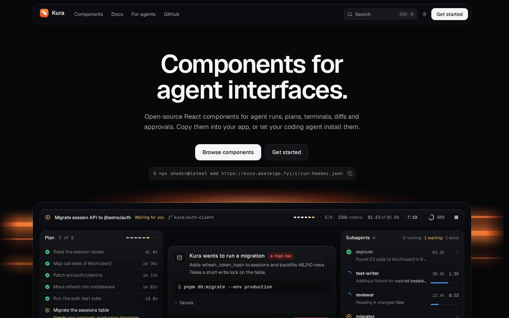
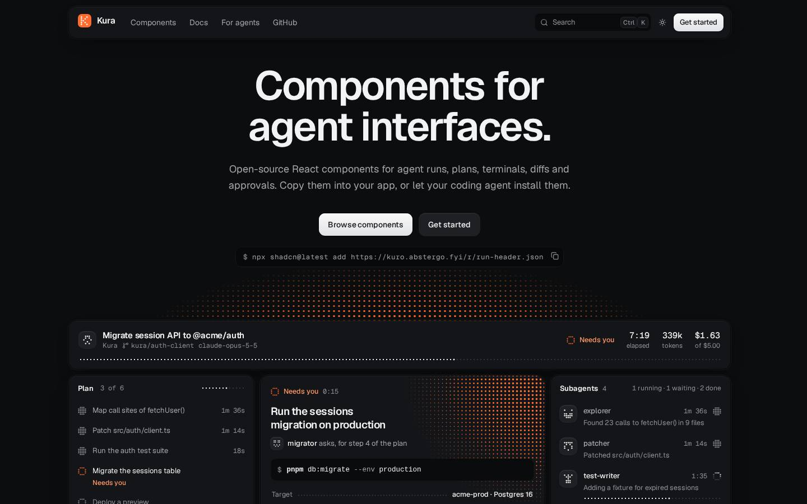
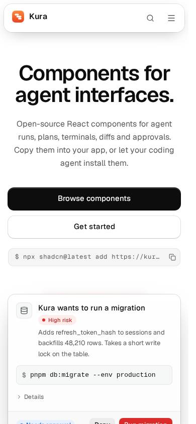
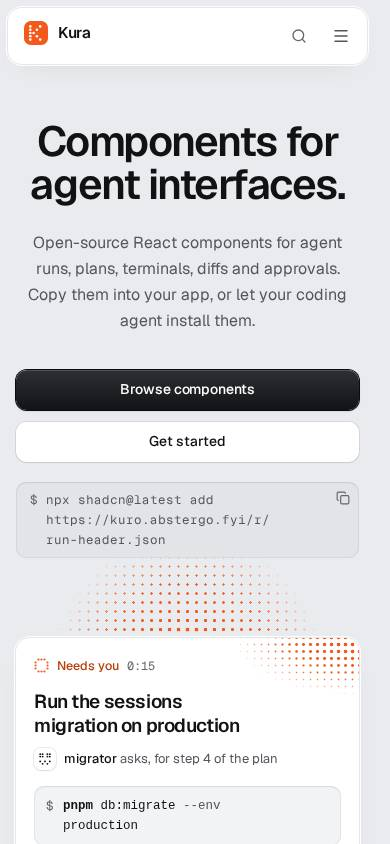
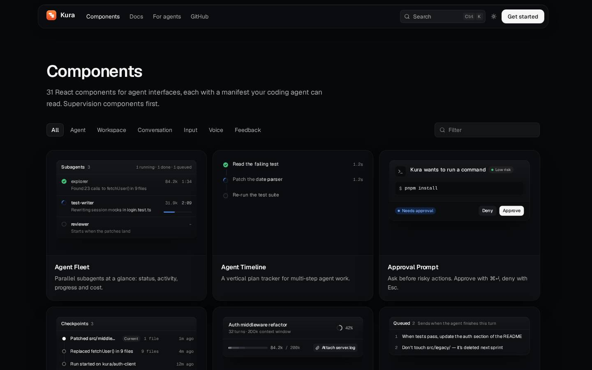
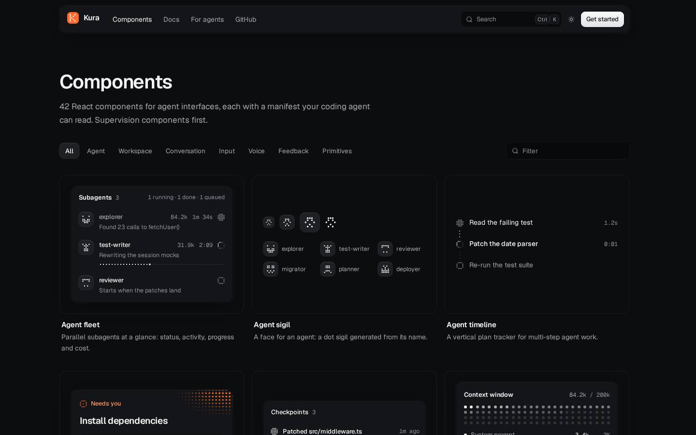
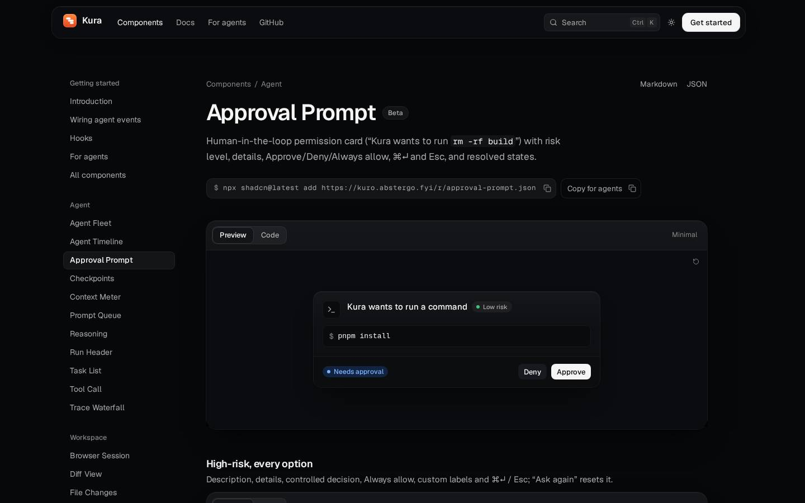
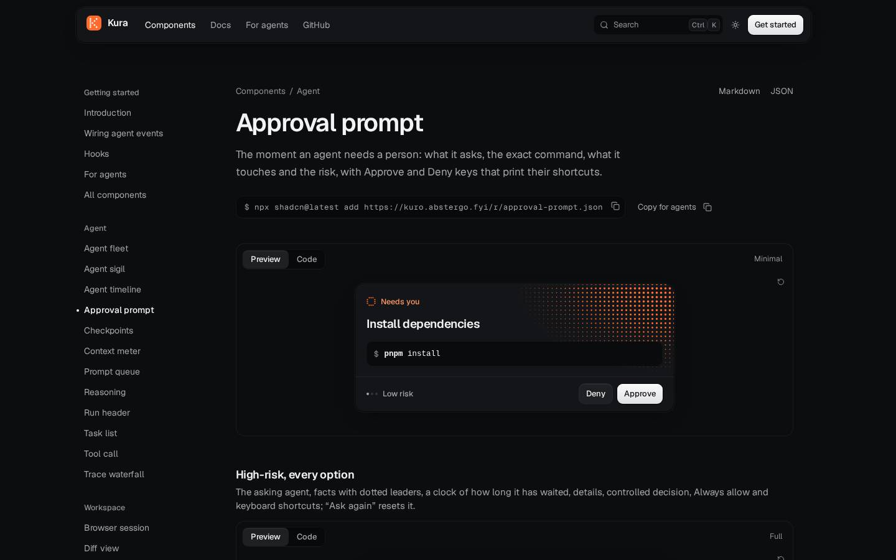
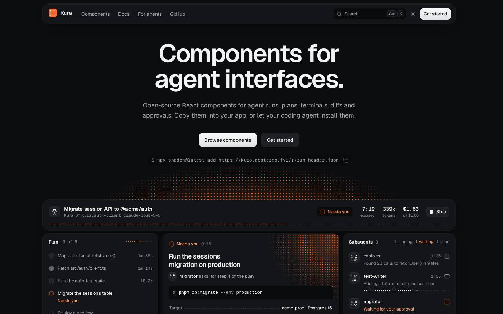
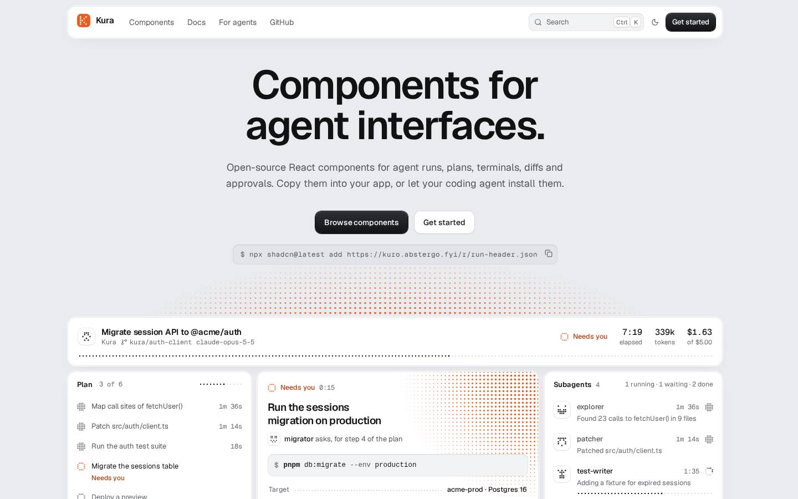

# v3 review log — the dot language (council method)

## Summary

**Result: Fable 5.2 at 9.5 and Opus 5.5 at 9.5 after eleven rounds.** Opus listed no must-fix in
rounds 10 and 11. Fable listed two one-line must-fixes in round 11; both were fixed in `5abde57`
and verified by script, but not re-reviewed: the owner closed the loop there and shipped it.

### What changed

- **A look with rules.** The v2 site ("Raycast-grade dark", 7.9 at best) was rejected for having
  no opinions. v3 is the dot language: agents emit tokens, so everything stateful or measured is
  drawn in dots. Status is a 5×5 glyph, every agent has a sigil, progress and traces are rails of
  dots, facts hang on dotted leaders, buttons are keycaps, and ember means one thing only: a
  person is needed. It leaves the screen once they decide.
- **The whole library on it.** All 43 components and the docs site were rebuilt on those seven
  rules and on Vercel's UI SDK, so an agent can read and operate the same controls a person does.
- **A hero that is a real run.** One agent run waiting on a high-risk approval, composed from
  live components that share one clock. Approving or denying moves the stage 0px at every width,
  with and without reduced motion, and every panel agrees on the numbers.
- **Keyboard and screen readers.** A visible ring on every Tab stop in both themes; focus never
  falls to `<body>` when a pressed control leaves; page-level keys stand down while typing,
  behind a modal, under a tooltip and while their card is off screen; axe is clean at every level
  on all 48 pages.
- **Phones.** No page scrolls sideways at any width; no overlay leaves the screen; labels wrap or
  give way in a set order instead of being cut to a few letters.
- **Guards that stay.** `packages/react/test/focus-ring.test.ts` (a ring that can actually draw),
  `packages/react/test/focus-fallback.test.tsx` (focus after a control leaves) and
  `design/v3/overflow.mjs` (every page, five widths).

### Before and after

|                      | Before (v2, round 2)                                     | After (v3, final)                                      |
| -------------------- | -------------------------------------------------------- | ------------------------------------------------------ |
| Home, dark, 1440     |        |        |
| Home, light, 390     |        |        |
| Components index     |       |       |
| Approval prompt page |  |  |

Within v3, the first build (round 1, 8.0 / 7.8) and the last, and the final light theme:

| Round 1                                             | Final                                            | Final, light                                            |
| --------------------------------------------------- | ------------------------------------------------ | ------------------------------------------------------- |
|  |  |  |

### What the loop cost, and why

Rounds 1 to 4 fixed what was plainly wrong (invisible focus rings, a hero that jumped, clocks a
second apart). From round 5 the scores moved a tenth at a time, because each round the reviewers
looked somewhere new (touch, short screens, spoken text) and found a few small, real defects.
Three of the fixes caused regressions that each cost a round: inline code that could not wrap
(round 6), the Composer's character hint (rounds 8 to 10), and a Ctrl+K guard that was too broad
(round 11). The overflow sweep and the focus tests exist so those cannot come back unseen.

One thing no reviewer could see: the Cloudflare Pages build had failed on every commit since the
rebuild, because the lab page read `?theme=` on the server and a static export cannot prerender
that. Fixed in `777d3dc`, before deploying.

### Scores by round

Two review-only reviewers per round: **Fable 5.2 (high effort)** and **Opus 5.5 (extra-high
effort)**. Fixed 14-shot set (`design/v3/shots.mjs`), scored on the 14-category rubric
(`RUBRIC.md`) against `DIRECTION.md`. A round passes when **both** score ≥ 9.5 with no Must-fix.

History before v3: the v2 direction ("Raycast-grade dark") reached 7.3 (R1) and 7.9 (R2) with one
reviewer (`design/v2/REVIEW-LOG.md`). The owner then rejected the look itself; v3 replaces it.

| Round | Fable 5.2 | Opus 5.5 | Notes                                                                                                                                                                                                                                                                              |
| ----- | --------- | -------- | ---------------------------------------------------------------------------------------------------------------------------------------------------------------------------------------------------------------------------------------------------------------------------------- |
| R1    | 8.0       | 7.8      | First full build on the dot language (commit 519f6c7). Identity lands (brand 9.0 from both); focus rings, mobile docs and loose edges hold it back.                                                                                                                                |
| R2    | 8.8*      | 8.5      | Commit 87f0d7b. Round-1 list largely closed. *Live checks were cut short: the docs dev server hit its 2-hour limit mid-review, so focus, 390px pages and motion are provisional.                                                                                                   |
| R3    | 9.1       | 8.9      | Commit e505f88. Fully verified live (48 pages, 192 axe runs, Tab walks, approve/deny at three widths). A decision now moves 0px; four to five small must-fixes remain.                                                                                                             |
| R4    | 9.2       | 9.2      | Commit d5d3374. Fully verified live. All round-3 must-fixes closed except the hero clocks (live values still a second apart). New: approval shortcuts leak from other widgets; terminals break words.                                                                              |
| R5    | 9.3       | 9.4      | Commit a6b1fec. Fully verified live. Every round-4 must-fix closed, no regressions. Left: focus lost when a pressed control unmounts, approval keys acting while the prompt is off screen, small phone seams.                                                                      |
| R6    | 9.3       | 9.3      | Commit 3423ff9. Fully verified live. Round-5 items closed, but one fix regressed: inline code that never wraps makes ten component pages scroll sideways. PromptQueue still loses focus in two cases and is cramped on touch.                                                      |
| R7    | 9.4       | 9.4      | Commit 790728c. Fully verified live. All round-6 must-fixes closed, no regressions, sweeps clean (overflow, axe at every level, rings). Left: one Composer example crushed on phones, the docs Replay key over previews at 390, two stale manifest lines.                          |
| R8    | 9.4       | 9.5      | Commit 149cc9b. Fully verified live. All round-7 must-fixes closed, no regressions. Opus is at the bar with one must-fix; Fable has four: a ModelPicker popover that can leave a short viewport, the Composer count on phones, phrases inside keycaps, two manifests naming Radix. |
| R9    | 9.5       | 9.5      | Commit ba72162. Fully verified live. Both at the bar; every round-8 claim holds. Not passed yet: three must-fixes remain (SlashCommandMenu and CommandPalette can leave a short viewport; the Composer count hides in a roomy toolbar on phones).                                  |
| R10   | 9.5       | 9.5      | Commit 7d62878. Fully verified live. **Opus: no must-fix (seat passed).** Fable: every round-9 claim holds; two must-fixes left (over the limit, a phone Composer shows nothing; the CommandPalette page prints shortcuts that collide with the site's ⌘K).                        |
| R11   | 9.5       | 9.5      | Commit a3e72d8. Fully verified live. **Opus: no must-fix, a second time.** Fable: every round-10 claim holds; two one-line must-fixes in the docs site (Ctrl+K swallowed while a non-modal popover is open; the hero announces "migrator done" five seconds early).                |

---

## Round 1 — commit 519f6c7

Shots: fixed 14-shot set. Both reviewers also sampled all 34 public component pages in both
themes, 390px layouts, approve/deny, ⌘K, reduced motion and axe.

| #   | Category                 | Fable 5.2 | Opus 5.5 |
| --- | ------------------------ | --------- | -------- |
| 1   | Visual hierarchy         | 8.4       | 8.2      |
| 2   | Typography               | 8.5       | 8.6      |
| 3   | Colour & state semantics | 8.2       | 8.1      |
| 4   | Layout & spacing         | 7.8       | 7.9      |
| 5   | Consistency              | 7.8       | 7.6      |
| 6   | Brand distinctiveness    | 9.0       | 9.0      |
| 7   | Clarity & density        | 8.2       | 8.3      |
| 8   | Interaction states       | 7.0       | 7.8      |
| 9   | Light/dark parity        | 8.6       | 9.1      |
| 10  | Craft & polish           | 7.6       | 7.7      |
| 11  | Accessibility            | 6.5       | 6.0      |
| 12  | Responsive               | 7.8       | 7.1      |
| 13  | Motion                   | 8.5       | 8.7      |
| 14  | Copy                     | 8.3       | 8.4      |
|     | **OVERALL**              | **8.0**   | **7.8**  |

### Must-fix (merged, ranked)

1. **No visible focus ring on any Button and most controls** (both). `outline-none` sets
   `--tw-outline-style: none`, so `focus-visible:outline-2` draws nothing. 23 sites.
2. **Hero stage breaks at 1024** (Fable): the focal prompt gets ~290px between two fixed columns.
3. **Axe serious** (both): ink-3 on selected rows 4.31:1 (AgentFleet, Trace); Composer shortcut
   hint 3.4/2.7:1; Trace row name mismatch; BrowserSession log not focusable at 390.
4. **Component pages at 390** (Opus): props table falls off the edge; copy button covers code;
   DiffView legend breaks; index cards cut live controls; two pages pan sideways (Fable).
5. **Ember as a border** on a paused BrowserSession; **light halftone reads as a wash** (Fable).
6. **Context meter page contradicts rule 3**: a ring and a 20-dot rail, no hundred dots (Opus).
7. **Home repeats itself**: the bento repeats Plan, Trace and Terminal from the stage; a "Works
   with" strip the direction does not list; stretched empty wells (Opus).
8. **Ember overuse on the stage** (~9 marks): Plan header rail, fleet summary (Opus).
9. **"Denied" drawn as a failure** (red cross) in ApprovalPrompt; elsewhere it is a dash (Opus).
10. **The agent demo asks twice at once**, and "wants to: Deploys" is ungrammatical (both).
11. **"Beta" pill on every component page** (both). **Primitives have no pages** (StatusGlyph 404)
    while the intro imports StatusGlyph (both).
12. **AgentTimeline glyph misaligned** on steps with children (Opus). **Hero Trace** worse than
    the reference: dead indent, short rail, no durations, "now" line collisions (Fable).
13. **DiffView right insets** 6–8px vs 12–16px left; **Terminal header** jammed right (both).
14. Example defects: content-width tool-call rows in the fleet composition, an empty placeholder
    sheet in PromptQueue, a circular play button, 390px clips in AgentFleet and ContextMeter.
15. Story errors: terminal says done at "batch 3 of 10"; "Told no" vs "Denied by you".

### Polish (merged)

One duration format; one easing curve; ThinkingIndicator orbit/wave are bars and a spinner;
PromptSuggestions and Attachment examples are generic; layout jump on approve; green bullets and
`⎿` in the install transcript; hover spec tags straddle the ring; ⌘K cube icons and sticky query;
Title Case names vs sentence case; BrowserSession mock text 5–9px; ContextMeter danger in red;
VoiceDictation bare mic and "Status: Idle"; `bouncy` spring in the docs; slogan-like closing
headline; RunHeader state chip reads as a badge in light; ApprovalPrompt footer inset; ModelPicker
capability icons; ToolCall tool icon; boxes inside boxes in three examples; weak first examples.

### Verified good (do not touch)

Hero at 1440 in both themes; the decision choreography; reduced motion (91 animations → 0); the
dot primitives, AgentOrb and AudioWaveform; TaskList, Checkpoints, RunHeader, Terminal,
FileChanges, Composer; nav, ⌘K layout, mobile nav, footer, sidebar marker, monochrome code; the
390px home.

---

## Round 2 — commit 87f0d7b

The docs dev server stopped mid-review (it reached its 2-hour background limit at 04:27), so
neither reviewer finished the live Tab walk, the 390px component pages, reduced motion or the
agent demo after it plays. Scores for interaction, accessibility, responsive and motion are
provisional. Both reviewers saw all 14 shots, home at six widths in both themes, approve/deny,
the full index and 15–20 component pages in both themes with axe.

| #   | Category                 | Fable 5.2 | Opus 5.5 |
| --- | ------------------------ | --------- | -------- |
| 1   | Visual hierarchy         | 8.9       | 8.9      |
| 2   | Typography               | 8.9       | 8.8      |
| 3   | Colour & state semantics | 9.0       | 8.8      |
| 4   | Layout & spacing         | 8.6       | 8.4      |
| 5   | Consistency              | 8.7       | 8.4      |
| 6   | Brand distinctiveness    | 9.3       | 9.2      |
| 7   | Clarity & density        | 8.9       | 8.7      |
| 8   | Interaction states       | 8.5*      | 8.5      |
| 9   | Light/dark parity        | 9.2       | 9.0      |
| 10  | Craft & polish           | 8.4       | 8.2      |
| 11  | Accessibility            | 8.3*      | 7.8      |
| 12  | Responsive               | 8.6*      | 8.6      |
| 13  | Motion                   | 8.8*      | 8.9      |
| 14  | Copy                     | 8.9       | 8.8      |
|     | **OVERALL**              | **8.8***  | **8.5**  |

### Round-1 verification

Fixed: hero at 1024; ember overuse; "denied" as a dash; home repetition and the "Works with"
strip; beta pill; timeline glyph; terminal header; story errors; light halftone wash; library
focus rings (source + guard test). Partly: hero Trace (still no durations, kind icons, short
rail); DiffView insets (16 vs 11px). Regressed: the BrowserSession halftone now runs under text;
removing ScaleToFit means index cards cut sheets mid-row; the stage reflows on a decision.

### Must-fix (merged, ranked)

1. **Invisible focus on the site** (Opus): the header search trigger and the Related chips use
   `outline-hidden` with no focus style. Extend the guard test to `apps/docs`.
2. **Two serious axe failures** (both): CodeBlock line numbers 2.7–3.5:1 (`opacity-70`);
   Citation domain key name does not start with its visible text.
3. **Components index cuts sheets mid-row** (both): never crop a sheet's ring; primitives sit
   left-anchored; the Status glyph card cuts a row; the Context meter card shows a 10-dot rail.
4. **A decision reflows the hero** (both): Plan loses its detail line (−20px), the migrator rail
   goes (−15px).
5. **Hero Trace below the reference** (both): no durations, Lucide kind icons, a ~22-dot rail.
6. **Paused BrowserSession halftone under text** (both).
7. Nav link wraps at 768; props table breaks names mid-word; browser mock is 3–6px on phones.

### Polish (merged)

Agent demo left column ends ~300px short; empty 288px stages; stale bento paragraph; ⌘↵ in prose
vs Ctrl ↵ on keys; ThinkingIndicator is a generic typing indicator; two Lucide status icons left
(message error, spinner example); light wells on the canvas read as raised; two input recipes on
/components; ringed hook chips; ContextPanel "Files" vs "Free" too close and no % on Free; red
"M" in a terminal example; halftone loses its fade under reduced motion; DiffView and
ApprovalPrompt each appear twice on home; JS durations do not mirror CSS; install transcript cut
at 390; capability icon map left in ModelPicker; a console 404 on two component pages.

### Verified good (do not touch)

Hero at 1440 and its 768–1279 recut; approve/deny choreography; ember discipline; ApprovalPrompt
page and resolved states; dot primitives, AgentOrb, AudioWaveform; AgentFleet, Checkpoints,
TaskList, Terminal, FileChanges, Composer; nav (≥1024), footer, closing call to action, "Built
right", the install table; ⌘K layout with a resetting query; 390px home; sentence-case titles.

---

## Round 3 — commit e505f88

The server ran for the whole review window, so nothing is provisional. Fable: Tab walk on 10
pages in both themes, axe on 48 pages × 4 configurations, hero at three widths, the agent demo
played through, ⌘K, 390px full pages of every component. Opus: Tab walk on all 47 pages, the same
axe matrix, measured heights through approve and deny, layout shift, 36 component pages.

| #   | Category                 | Fable 5.2 | Opus 5.5 |
| --- | ------------------------ | --------- | -------- |
| 1   | Visual hierarchy         | 9.2       | 9.1      |
| 2   | Typography               | 9.1       | 9.0      |
| 3   | Colour & state semantics | 9.2       | 9.3      |
| 4   | Layout & spacing         | 9.0       | 8.8      |
| 5   | Consistency              | 9.0       | 8.8      |
| 6   | Brand distinctiveness    | 9.5       | 9.4      |
| 7   | Clarity & density        | 9.0       | 9.0      |
| 8   | Interaction states       | 9.0       | 8.9      |
| 9   | Light/dark parity        | 9.3       | 9.3      |
| 10  | Craft & polish           | 8.8       | 8.7      |
| 11  | Accessibility            | 8.7       | 8.6      |
| 12  | Responsive               | 8.9       | 8.9      |
| 13  | Motion                   | 9.3       | 9.2      |
| 14  | Copy                     | 9.1       | 8.9      |
|     | **OVERALL**              | **9.1**   | **8.9**  |

### Round-2 verification

All seven round-2 must-fixes verified fixed (site focus, the two axe failures, whole index
cards, no reflow on a decision — measured 0px at 1440, 1024 and 390 —, the BrowserSession
halftone, nav/props/browser mock), except the hero Trace, which is "partly": durations and dot
kinds landed, but the rail now touches them. No regressions.

### Must-fix (merged, ranked)

1. **Every docs code well has a second, invisible tab stop** (both): Shiki puts `tabindex="0"`
   on its `<pre>`; the wrapper hides that outline. **⌘K drops focus to `<body>` on close**
   (Fable).
2. **Pressed toggles lose their focus ring** in two copy-paste examples (Opus).
3. **One serious axe failure at 390** (both): a hand-rolled scrolling `<pre>` in a TaskList
   example.
4. **Hero Trace** (both): the rail and the now-line run into the durations; names shrink to ~6
   characters when narrow; its numbers contradict the Plan, Terminal and Subagents.
5. **A native blue × in the Components filter** in light (Fable).
6. **ApprovalPrompt halftone runs under text at 390** (Fable).

### Polish (merged)

Terminals hard-clip at 390 (hero, install transcript); the agent demo shifts on phones while it
plays; the filter is silently scoped to the active tab; ⌘ in prose where keys print Ctrl; 10.5px
keycap text; ModelPicker empty state; two titles promise icons that are gone; green Lucide checks
in a Spinner example; ToolCall examples still pass kind icons; ragged hero column bottoms; the
category row is cut at 390; diff lines end flush on the sheet edge; ThinkingIndicator is still a
generic typing indicator; ⌘K says "Getting started" where the sidebar says "Introduction"; copy
has no failure path; the hero re-asks after 12s.

### Verified good (do not touch)

Hero at every width and its decision choreography (zero movement, ember leaves, 0 animations
under reduced motion); ember discipline; the components index; the component page template at
390; desktop TraceWaterfall; AgentFleet, TaskList, FileChanges, DiffView review flow, Checkpoints,
PromptQueue, ContextPanel, StatusGlyph, DotRail, Halftone, AgentOrb, AudioWaveform; Composer's
ring; ModelPicker; ⌘K layout and ranking; mobile nav; nav, footer, "Built right", the install
table, the closing call to action; light wells; no horizontal overflow and one h1 on all pages.

---

## Round 4 — commit d5d3374

Both reviewers ran everything live: Tab walks (12 and 7+ pages, both themes), axe on 48 pages × 4
configurations (0 serious/critical after re-running two transient streaming-text hits), approve
and deny at 1440, 1024 and 390, reduced motion, ⌘K, 390px full pages.

| #   | Category                 | Fable 5.2 | Opus 5.5 |
| --- | ------------------------ | --------- | -------- |
| 1   | Visual hierarchy         | 9.4       | 9.3      |
| 2   | Typography               | 9.3       | 9.2      |
| 3   | Colour & state semantics | 9.5       | 9.3      |
| 4   | Layout & spacing         | 9.1       | 9.1      |
| 5   | Consistency              | 9.3       | 9.1      |
| 6   | Brand distinctiveness    | 9.6       | 9.5      |
| 7   | Clarity & density        | 9.3       | 9.2      |
| 8   | Interaction states       | 8.8       | 9.3      |
| 9   | Light/dark parity        | 9.5       | 9.4      |
| 10  | Craft & polish           | 9.1       | 8.9      |
| 11  | Accessibility            | 9.1       | 9.3      |
| 12  | Responsive               | 9.2       | 9.0      |
| 13  | Motion                   | 9.4       | 9.3      |
| 14  | Copy                     | 9.1       | 9.2      |
|     | **OVERALL**              | **9.2**   | **9.2**  |

### Round-3 verification

Fixed: the second tab stop in code wells; ⌘K focus return; pressed toggles; the TaskList axe
failure; the native blue ×; the halftone under text at 390; the stacked narrow Trace (no
collision, readable names). Partly: the hero's numbers — finished durations agree, live ones are
a second apart about 75% of the time. No regressions except terminals, which now wrap but break
words mid-word.

### Must-fix (merged, ranked)

1. **Approval keys fire from other widgets** (Fable): Ctrl+Enter in the bento Composer also
   approves the hero's migration; Esc closing the mobile nav denies it.
2. **ApprovalPrompt drops focus to `<body>` after a keyboard decision** (Fable): the actions row
   goes inert while it holds focus.
3. **Hero clocks disagree** (both): the Trace rounds where clocks floor; the Terminal's clock
   never resets for the second command; "5.1s" plays in about 3.1s.
4. **Terminals split words mid-word** (both): `break-all`, visible on the home page at 1440.
5. **Three manifest sentences contradict the direction** (Fable): "blue default", "AI signal
   colour", "use a progress bar".
6. **Needs-you labels truncate at 390** (both): "Paused fo…", "Nee…".

### Polish (merged)

Hero at 768–1279 has a 39px gap and a short right column; at 1440 the stretched Context sheet is
~40% empty; a live duration is shown three ways (clock, duration, decimal seconds); Trace shows no
glyph for skipped or paused spans; install transcript at 390 starts scrolled; the agent demo
terminal clips and grows a few px on phones; ArtifactCard preview cuts a line through its
letters; a dead Stop key in the hero; three sub-11px labels; Spinner pulses under reduced motion
while the glyph holds still; two ⌘ glyphs left in manifests; an unlabelled row in a
ThinkingIndicator example; an off-centre VoiceDictation example; a demo diff line 19px too long.

### Verified good (do not touch)

Hero decision choreography (0px at three widths), ember discipline, the stacked narrow Trace,
focus rings on every stop, ⌘K, the components filter and its empty state, mobile nav, DiffView
review flow, the whole component set in both themes, home sections at 1440 and 390, axe clean on
all 48 pages, one h1 and no horizontal overflow everywhere.

## Round 5 — commit a6b1fec

Both reviewers ran everything live: Tab walks (20 and 7 pages, both themes), axe on 48 pages × 4
configurations (0 serious/critical), approve and deny at five widths, reduced motion, ⌘K, 390px
full pages, clocks sampled every 60ms.

| #   | Category                 | Fable 5.2 | Opus 5.5 |
| --- | ------------------------ | --------- | -------- |
| 1   | Visual hierarchy         | 9.5       | 9.5      |
| 2   | Typography               | 9.4       | 9.4      |
| 3   | Colour & state semantics | 9.6       | 9.6      |
| 4   | Layout & spacing         | 9.4       | 9.4      |
| 5   | Consistency              | 9.3       | 9.4      |
| 6   | Brand distinctiveness    | 9.7       | 9.6      |
| 7   | Clarity & density        | 9.4       | 9.4      |
| 8   | Interaction states       | 9.1       | 9.3      |
| 9   | Light/dark parity        | 9.6       | 9.5      |
| 10  | Craft & polish           | 9.3       | 9.2      |
| 11  | Accessibility            | 9.1       | 9.4      |
| 12  | Responsive               | 9.3       | 9.3      |
| 13  | Motion                   | 9.4       | 9.5      |
| 14  | Copy                     | 9.5       | 9.4      |
|     | **OVERALL**              | **9.3**   | **9.4**  |

### Round-4 verification

All six must-fixes fixed: approval keys stay put from a composer, ⌘K and the mobile nav; focus
lands on the card with a ring after a keyboard decision; every hero clock agrees and the
migration takes the 5.1s it reports; terminals wrap at spaces; manifests are clean; "Paused for
you" is whole (the compact fleet row is better, still cut mid-word). Polish: hero level from 768
to 1680 with 0px movement, no stretched sheet, skipped glyph, whole install transcript, steady
demo terminal, whole-line ArtifactCard preview, still Spinner. Not fixed: a DiffView example line
still overflows. No regressions.

### Must-fix (merged, ranked)

1. **Approval keys decide a prompt that is off screen** (Opus): Ctrl+Enter from the footer
   approved the hero's migration.
2. **Focus drops to `<body>` when the pressed control unmounts** (Fable): PromptQueue Remove and
   Send now, RunHeader Stop, DiffView Accept all / Reject all, Terminal "Show all", BrowserSession
   Resume, AttachmentList Remove; two examples.
3. **Esc with a tooltip showing denies the request** (Fable) and leaves the tooltip up.
4. **AgentTimeline ticks decimal seconds** (Fable) where everything else shows a clock.
5. **StreamingText's caret pulses under reduced motion** (Fable): the data variant outranks
   `motion-reduce`.
6. **BrowserSession target label is clipped** (both): past the frame at 390, ellipsised by 3px
   at 1440.

### Polish (merged)

Wrapped terminal lines have no hanging indent; inline code and paths break at hyphens; CodeBlock
repeats the language beside a filename and truncates the name at 390; DiffView minimal example is
too narrow for its longest line; the fleet summary hides a count after deny; the test terminal's
clock reads 0:02 then "1.8s"; phone labels cut to a few letters (Checkpoints, RunHeader title,
PromptQueue hint, compact fleet); RunHeader compact title cut by 5px with room to spare;
ModelPicker footer clamps mid-item; VoiceDictation minimal is a lone ghost mic; a typing caret in
a BrowserSession example pulses under reduced motion; the dark install well nearly vanishes on the
canvas; the approval card states the decision twice; moderate axe (heading order at 390, duplicate
landmark names); "⌘↵" hard-coded in one manifest line; "Your agent can install it." right column
ends 150px short.

### Verified good (do not touch)

Hero choreography and the shared clock, approval key scoping for composer/⌘K/nav, the ring on the
card after a keyboard decision, focus return from ⌘K/Popover/CommandPalette/ModelPicker, rings on
every stop, 0 running animations under reduced motion on every other page, ember discipline, the
stacked narrow Trace, AgentFleet layouts, DiffView per-hunk flow, home at 390, the components
index and docs pages, axe clean on all 48 pages.

## Round 6 — commit 3423ff9

Both reviewers ran everything live: the round-5 claims one by one, Tab walks (12 and 8 pages, both
themes), axe on 48 pages × 4 configurations (0 serious/critical), approve and deny at five widths,
reduced motion, ⌘K, 390px full pages of all 48 pages.

| #   | Category                 | Fable 5.2 | Opus 5.5 |
| --- | ------------------------ | --------- | -------- |
| 1   | Visual hierarchy         | 9.5       | 9.5      |
| 2   | Typography               | 9.4       | 9.4      |
| 3   | Colour & state semantics | 9.6       | 9.6      |
| 4   | Layout & spacing         | 9.2       | 9.2      |
| 5   | Consistency              | 9.4       | 9.4      |
| 6   | Brand distinctiveness    | 9.7       | 9.7      |
| 7   | Clarity & density        | 9.5       | 9.3      |
| 8   | Interaction states       | 9.3       | 9.4      |
| 9   | Light/dark parity        | 9.6       | 9.6      |
| 10  | Craft & polish           | 9.1       | 9.0      |
| 11  | Accessibility            | 9.3       | 9.3      |
| 12  | Responsive               | 9.0       | 8.9      |
| 13  | Motion                   | 9.4       | 9.6      |
| 14  | Copy                     | 9.5       | 9.5      |
|     | **OVERALL**              | **9.3**   | **9.3**  |

### Round-5 verification

Fixed: focus fallback on RunHeader, DiffView, Terminal, BrowserSession, AttachmentList, ToolCall
and "Ask again" (ring after keyboard, none after a click); approval keys off screen and under a
tooltip; AgentTimeline clock; carets under reduced motion; the highlight tag; terminal hanging
indents, whole flags and package names; CodeBlock language label; DiffView examples; RunHeader
bar columns and two-line phone title; PromptQueue hint; hero counts, clocks, levels and 0px
movement; the dark well; the install section. Partly: PromptQueue focus (fine while a row
remains). Regressed: inline code in prose (see must-fix 1).

### Must-fix (merged, ranked)

1. **Component pages scroll sideways** (both; regression): `C` is `whitespace-nowrap` and every
   backticked span in a manifest goes through it, so a long type or statement cannot wrap.
   diff-view and file-changes overflow from 1440 down; eight pages at 390.
2. **PromptQueue drops focus** (both): removing or sending the last prompt, and the Move down
   key every time.
3. **PromptQueue rows are unreadable on touch** (Opus): all five actions show on every row, so
   the text keeps one to nine characters.
4. **Hero clocks disagree under reduced motion** (Fable): the migration lands at once and its
   span ends in the future.

### Polish (merged)

Terminal splits a URL after its scheme and code mid-identifier, and `git status` rows hang under
the status letter; ModelPicker's description is cut mid-word; the hooks lede splits a package
name; `<DiffView />` splits at its space in the phone transcript; the RunHeader manifest still
says the title truncates; duplicate landmark names on two example pages; Checkpoints labels cut
by a few px beside a wide time cell on touch; a RunHeader bar title cut by 8px beside a status
label that repeats the glyph; the install section's terminal is padded with empty space (Opus)
where round 5 asked for level columns (Fable).

### Verified good (do not touch)

`useFocusFallback` and its wiring, approval key scoping, hero choreography and numbers at five
widths, AgentTimeline clock, RunHeader bar columns, terminal hanging indents, rings on every stop
in both themes, axe clean, BrowserSession tag, CodeBlock labels, the dark well, home at 390 and
768, ember discipline.

## Round 7 — commit 790728c

Both reviewers ran everything live: the round-6 claims one by one, a sideways-scroll sweep of 48
pages at four to five widths (0 pages), axe on 48 pages × 4 configurations (clean at every
level), Tab walks (17 and 7 pages, both themes), approve and deny at five widths with and
without reduced motion, ⌘K, phone screenshots with touch emulation.

| #   | Category                 | Fable 5.2 | Opus 5.5 |
| --- | ------------------------ | --------- | -------- |
| 1   | Visual hierarchy         | 9.6       | 9.5      |
| 2   | Typography               | 9.5       | 9.5      |
| 3   | Colour & state semantics | 9.6       | 9.6      |
| 4   | Layout & spacing         | 9.4       | 9.4      |
| 5   | Consistency              | 9.4       | 9.4      |
| 6   | Brand distinctiveness    | 9.7       | 9.7      |
| 7   | Clarity & density        | 9.5       | 9.5      |
| 8   | Interaction states       | 9.5       | 9.5      |
| 9   | Light/dark parity        | 9.6       | 9.6      |
| 10  | Craft & polish           | 9.3       | 9.3      |
| 11  | Accessibility            | 9.5       | 9.5      |
| 12  | Responsive               | 9.2       | 9.3      |
| 13  | Motion                   | 9.6       | 9.6      |
| 14  | Copy                     | 9.4       | 9.4      |
|     | **OVERALL**              | **9.4**   | **9.4**  |

### Round-6 verification

Fixed: no page scrolls sideways; PromptQueue focus (Move keys, the last prompt) and its touch
layout; hero clocks under reduced motion; Terminal joints and hanging indents; ModelPicker's
fixed strip; the hooks lede and `<DiffView />`; moderate axe; Checkpoints on touch; the install
section. Not fixed: a RunHeader bar title still cut by 8px in one Checkpoints example (the status
word joins too early); two manifest lines left behind by round 6's changes.

### Must-fix (merged, ranked)

1. **Composer example crushed on phones** (Fable): at 390–430 the model picker trigger is 16px
   wide (name and chevron gone) while an invisible hint holds 75px beside the send key.
2. **The docs Replay key sits on the example at 390** (Opus): 77 of 151 previews.
3. **Two manifest lines contradict their neighbours** (both): DiffView "labelled section",
   RunHeader title "truncated".

### Polish (merged)

RunHeader bar status word should join later (title cut at 576px); TraceWaterfall's span detail
is sheet → well → raised cards; Ctrl+K does not close the site palette on Windows/Linux; RunHeader
bar on a phone keeps empty control slots; a PromptQueue example hint speaks of hover and keys on
touch; two sentences end in an ellipsis at 390 (Composer status, ArtifactCard failure); small
touch targets on Attachment; SlashCommandMenu previews open empty; the Installation command is
cut hard on phones; AgentFleet reads the percentage before the name; an emptied PromptQueue
leaves focus on a line nobody sees; a wiring-page code line is cut at 1440; two Replay keys on
one trace example; a no-wrap Terminal's "Show all" rule runs off the well.

### Verified good (do not touch)

The overflow guard and the `C` wrap rule, PromptQueue focus and touch layout, hero choreography
and clocks (five widths, both motion settings, both themes), ModelPicker's strip, Terminal
wrapping, Checkpoints on touch, the install section, focus fallbacks, approval key scoping, ⌘K,
reduced motion, ember discipline, axe at every level.

## Round 8 — commit 149cc9b

Both reviewers ran everything live: the round-7 claims one by one, a sideways-scroll sweep (0 of
48 pages at four to five widths), axe on 48 pages × 4 configurations (0 serious/critical), Tab
walks on 7 pages in both themes, approve and deny at three widths with and without reduced
motion, Ctrl+K and ⌘K, phone screenshots with touch emulation.

| #   | Category                 | Fable 5.2 | Opus 5.5 |
| --- | ------------------------ | --------- | -------- |
| 1   | Visual hierarchy         | 9.6       | 9.5      |
| 2   | Typography               | 9.5       | 9.5      |
| 3   | Colour & state semantics | 9.6       | 9.6      |
| 4   | Layout & spacing         | 9.4       | 9.5      |
| 5   | Consistency              | 9.4       | 9.4      |
| 6   | Brand distinctiveness    | 9.7       | 9.7      |
| 7   | Clarity & density        | 9.5       | 9.5      |
| 8   | Interaction states       | 9.4       | 9.5      |
| 9   | Light/dark parity        | 9.6       | 9.6      |
| 10  | Craft & polish           | 9.3       | 9.4      |
| 11  | Accessibility            | 9.5       | 9.5      |
| 12  | Responsive               | 9.3       | 9.4      |
| 13  | Motion                   | 9.6       | 9.6      |
| 14  | Copy                     | 9.4       | 9.5      |
|     | **OVERALL**              | **9.4**   | **9.5**  |

### Round-7 verification

Fixed: the Composer toolbar at rest on phones; the Replay key (0 of 151 previews overlap, never
two keys); both manifest lines; RunHeader bar's status word and phone slots; the trace detail on
the sheet with wells; Ctrl+K; PromptQueue's touch hint and focus hand-off; ArtifactCard's
two-line reason; Attachment's Retry target; AgentFleet's reading order; the no-wrap Terminal's
"Show all"; the Installation command (wraps whole, copies exactly). Partly: the wiring page (one
of three code blocks). No regressions.

### Must-fix (merged, ranked)

1. **ModelPicker popover leaves the viewport** (Fable) when fewer than 428px are available: the
   list keeps 320px whatever the search row and details strip take.
2. **Composer: the character count lands on a toolbar key on phones** (Fable) once it shows.
3. **DiffView: a renamed file's new name disappears at 390** (Opus): old and new path shrink
   equally.
4. **Keyboard tables: a phrase inside a keycap** (Fable) wraps and escapes the cap at 390.
5. **Two manifests say Radix** (Fable) for parts that come from ui-sdk; the README too.

### Polish (merged)

Five wiring-page code lines still cut at 1440; the same install command is cut in the page-head
and hero chips but wrapped in Installation, and 25 file names split at a hyphen; the Kura CLI tab
cuts a comment line at 390; TaskList cuts titles where AgentTimeline wraps them; an Attachment
example hint says "Hover" on touch; the hidden Composer hint still holds a gap; a FileChanges
example is a 1600px wrapped diff at 390; a RunHeader manifest note predates the 672px rule; the
AgentOrb state switch wraps one key alone at 390.

### Verified good (do not touch)

The overflow guard, hero choreography and clocks, the preview stage's phone padding and single
Replay key, the trace detail, RunHeader bar rules, Ctrl+K and ⌘K, PromptQueue hand-off, the
sticky "Show all", focus rings, axe, ember discipline, reduced motion.

Kept on purpose: the approval card's state label plus outcome sentence; single-line compact rows
end in an ellipsis; SlashCommandMenu previews rest empty (a preview must not take focus on load);
BrowserSession's highlight tag is an overlay and may sit over the page it annotates.

## Round 9 — commit ba72162

Both reviewers ran everything live: the round-8 claims one by one (75 ModelPicker opens, 42 pages
of install chips and keyboard tables), a sideways-scroll sweep (0 of 48 pages), axe on 48 pages ×
4 configurations (0 serious/critical), Tab walks on 7 pages in both themes (about 690 stops per
theme, 0 missing rings), approve and deny at three widths with and without reduced motion, every
popover, menu and dialog at 390×667 and 1440×600.

| #   | Category                 | Fable 5.2 | Opus 5.5 |
| --- | ------------------------ | --------- | -------- |
| 1   | Visual hierarchy         | 9.6       | 9.5      |
| 2   | Typography               | 9.6       | 9.5      |
| 3   | Colour & state semantics | 9.6       | 9.5      |
| 4   | Layout & spacing         | 9.5       | 9.5      |
| 5   | Consistency              | 9.5       | 9.5      |
| 6   | Brand distinctiveness    | 9.7       | 9.7      |
| 7   | Clarity & density        | 9.6       | 9.4      |
| 8   | Interaction states       | 9.4       | 9.5      |
| 9   | Light/dark parity        | 9.6       | 9.6      |
| 10  | Craft & polish           | 9.4       | 9.4      |
| 11  | Accessibility            | 9.5       | 9.5      |
| 12  | Responsive               | 9.4       | 9.5      |
| 13  | Motion                   | 9.6       | 9.6      |
| 14  | Copy                     | 9.5       | 9.5      |
|     | **OVERALL**              | **9.5**   | **9.5**  |

### Round-8 verification

All fixed, no regressions in what was claimed: ModelPicker inside the viewport at four sizes; no
count-over-tools overlap at 360/390/430; the renamed file's name; keyboard tables; ui-sdk wording;
the install command (0 bad breaks on 42 pages × 2 places, copies exactly); the wiring page; TaskList
titles; the smaller items. Spot-checks hold: 0px hero movement, agreeing clocks, rings, approval
key scoping, Ctrl+K.

### Must-fix (merged, ranked)

1. **SlashCommandMenu leaves the viewport** (Fable): with `side="top"` and the field near the top
   of the screen its first commands are off screen (−144px at 390×667); `auto` misses by a few px
   on short screens. It picks a side but never limits its height to the room there.
2. **Composer: the count disappears in a roomy toolbar** (Opus; a regression from round 8's
   fix): the hint shortens itself by the toolbar's width, not by the room that is actually free,
   so on a phone it shows a bare ring beside two buttons, which reads like a queued glyph.
3. **CommandPalette runs 2–8px past the bottom** (Fable) at viewport heights 600–650.

### Polish (merged)

Code lines still cut at 1440 on /docs/hooks, /docs and /agents; the count ring over a key at
320px; a RunHeader manifest threshold (branch shows from ~1024px, not ~768px); AgentFleet sample
activity a few px too long; a duplicated title in a FileChanges example; dotted guides ending in
half a dot; "gradient" in ShimmerText's description; the squeezed ModelPicker trigger should keep
the end of the name ("…Sonnet 5.5"); a deleted file's name cut beside "+0"; the character count
is not in the field's spoken description.

Follow-up, not part of this loop: the docs site's own chrome (tabs, mobile nav, ⌘K dialog) still
runs on radix-ui and cmdk; moving it to ui-sdk is plumbing nobody sees.

### Verified good (do not touch)

ModelPicker's fit rule, DiffView's rename header, the Keys renderer, InstallChip and wrapping
shell blocks, TaskList's two-line titles, hero choreography and clocks, the overflow guard, focus
rings and hand-offs, approval key scoping, the mobile nav, ember discipline, reduced motion.

## Round 10 — commit 7d62878

Both reviewers ran everything live: the round-9 claims (54 and 24 SlashCommandMenu opens, the
palette at eight viewport heights, the Composer hint at eleven widths), a sideways-scroll sweep
(0 of 48 pages at four widths), axe on 48 pages × 4 configurations (0 serious/critical), Tab
walks on 7 pages in both themes (614 stops per theme, none without a ring), approve and deny at
three widths with and without reduced motion, every overlay at 390×667 and 1440×600.

| #   | Category                 | Fable 5.2 | Opus 5.5 |
| --- | ------------------------ | --------- | -------- |
| 1   | Visual hierarchy         | 9.6       | 9.6      |
| 2   | Typography               | 9.6       | 9.5      |
| 3   | Colour & state semantics | 9.6       | 9.6      |
| 4   | Layout & spacing         | 9.6       | 9.5      |
| 5   | Consistency              | 9.5       | 9.5      |
| 6   | Brand distinctiveness    | 9.7       | 9.7      |
| 7   | Clarity & density        | 9.6       | 9.5      |
| 8   | Interaction states       | 9.3       | 9.5      |
| 9   | Light/dark parity        | 9.6       | 9.6      |
| 10  | Craft & polish           | 9.5       | 9.5      |
| 11  | Accessibility            | 9.4       | 9.5      |
| 12  | Responsive               | 9.5       | 9.5      |
| 13  | Motion                   | 9.6       | 9.6      |
| 14  | Copy                     | 9.4       | 9.5      |
|     | **OVERALL**              | **9.5**   | **9.5**  |

### Round-9 verification

All fixed, no regressions: SlashCommandMenu inside the viewport with its highlighted command
visible at every size tried; CommandPalette 16px short of the bottom edge at any height; the
Composer hint measures its own room (the count is back in a roomy toolbar, no overlaps at eleven
widths); the squeezed ModelPicker trigger keeps the end of the name; one-sided diff counts;
whole-dot leaders; no code block scrolls on the four docs pages; the smaller copy items.

### Must-fix

Opus: **none.**

Fable:

1. **Composer: over the limit, a phone toolbar shows nothing.** The hint has no room and steps
   out, so Send goes disabled with no visible reason (from 540px up the count shows in red).
2. **CommandPalette page: printed shortcuts that do not open their palette.** The Full example
   binds and prints Ctrl+K, which the site search owns; with the example palette open, Ctrl+K
   stacks the site palette on top of it; two more examples print a key they do not bind.

### Polish (merged)

The field's spoken description is doubled while the hint is hidden; two Composer copy
mismatches (an example titled "over limit" shows "close to", and a quoted description uses
3,400 where "close" starts at 3,600); SlashCommandMenu with `auto` changes side as the list
filters, and measures the layout viewport rather than the visual one (on-screen keyboard);
DiffView's spoken counts say "1 additions"; the CommandPalette trigger prints a key on touch;
"…t 5.5" in the model trigger at 360px.

### Verified good (do not touch)

Overlay fit rules (SlashCommandMenu, CommandPalette, ModelPicker), the hint as its own size
container, end-of-name truncation, DiffView counts and rename header, whole-dot leaders, the docs
code blocks, hero choreography and clocks, the overflow guard, focus rings and hand-offs,
approval key scoping, ember discipline, reduced motion, the mobile hero stack.

## Round 11 — commit a3e72d8

Both reviewers ran everything live: the round-10 claims (the over-limit Composer at ten widths,
the palette keys, the slash menu's side at twelve positions), a sideways-scroll sweep (0 of 48
pages at up to seven configurations), axe (240 page runs, 0 serious/critical), Tab walks (616 to
662 stops per theme, none without a ring), approve and deny at three widths with and without
reduced motion, every overlay at 390×667 and 1440×600, about 60 phone screenshots.

| #   | Category                 | Fable 5.2 | Opus 5.5 |
| --- | ------------------------ | --------- | -------- |
| 1   | Visual hierarchy         | 9.6       | 9.6      |
| 2   | Typography               | 9.6       | 9.5      |
| 3   | Colour & state semantics | 9.6       | 9.6      |
| 4   | Layout & spacing         | 9.6       | 9.5      |
| 5   | Consistency              | 9.5       | 9.5      |
| 6   | Brand distinctiveness    | 9.7       | 9.7      |
| 7   | Clarity & density        | 9.6       | 9.5      |
| 8   | Interaction states       | 9.4       | 9.5      |
| 9   | Light/dark parity        | 9.6       | 9.6      |
| 10  | Craft & polish           | 9.5       | 9.5      |
| 11  | Accessibility            | 9.4       | 9.6      |
| 12  | Responsive               | 9.6       | 9.6      |
| 13  | Motion                   | 9.6       | 9.6      |
| 14  | Copy                     | 9.5       | 9.5      |
|     | **OVERALL**              | **9.5**   | **9.5**  |

### Round-10 verification

All fixed: the over-limit count is red and on screen at every width from 320 to 1440 (two rows
on phones, no overlaps); the description is said once; the states example and its copy; the
palette binds what it prints and the site search no longer stacks on it; the slash menu keeps
its side while the list filters; DiffView's spoken counts.

### Must-fix

Opus: **none.**

Fable (both in the docs site, both one line):

1. **Ctrl+K is swallowed while a Popover or ModelPicker is open** (a side effect of round 10's
   guard, which matches any `role="dialog"`; Kura's non-modal popovers carry that role).
2. **The hero tells screen readers "migrator done" as soon as you approve**, five seconds before
   it is true: for one render the migration's lines are still those of the pending state.

### Polish (merged)

The library palette's own hotkey can open over another modal; AgentFleet does not repeat an
identical announcement; between 540 and 600px the over-limit count drops its limit; two code
comments still say "amber"; mixed punctuation in an example's state labels; key hints inside the
palette on touch; a docs-only comment in copy-paste code; the slash menu follows a field that
has scrolled off screen.

### Verified good (do not touch)

The Composer's over-limit wrap and single description, the slash menu's side rule, palette keys,
DiffView counts, hero choreography and clocks, overlay fit rules, the overflow guard, focus rings
and hand-offs, phone compositions, ember discipline.
